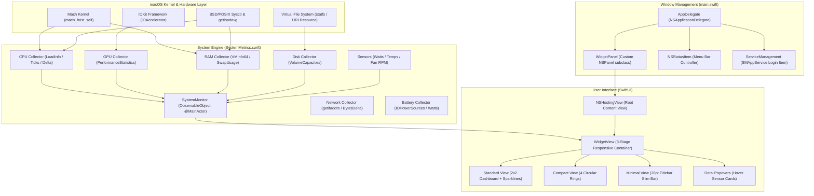

# CGPU Monitor 기술 아키텍처 및 구현 문서 (Technical Architecture & Engineering Documentation)

macOS (Apple Silicon & Intel) 환경에서 동작하는 고성능 실시간 시스템 모니터링 데스크톱 위젯 & 메뉴바 애플리케이션인 **CGPU Monitor**의 전체 아키텍처, 핵심 저수준(Low-level) 시스템 API 수집 기술, SwiftUI/AppKit 하이브리드 UI 설계, 그리고 개발 과정에서 해결된 기술적 이슈와 해결책을 기록한 공식 문서입니다.

---

## 1. 시스템 전체 아키텍처 (System Architecture)

CGPU Monitor는 **AppKit(WindowServer 제어 및 메뉴바 상주)**과 **SwiftUI(반투명 글래스 반응형 UI)**를 결합한 하이브리드 아키텍처를 채택하고 있습니다. 또한 백그라운드에서 Mach 커널 및 IOKit 하드웨어 센서를 1초 주기로 폴링하여 UI에 비동기 전달합니다.



---

## 2. 모듈별 역할 및 소스 구조

```
cgpu/
├── Package.swift                             # Swift Package Manager 설정
├── build.sh                                  # 독립 네이티브 빌드 & .app 패키징 스크립트
├── make_dmg.sh                               # 배포용 DMG 인스톨러 자동 생성 스크립트
├── generate_icon.swift                       # 1024x1024 네이티브 AppIcon 생성기
├── generate_dmg_background.swift             # DMG 인스톨러용 1200x800 레티나 배경 생성기
├── AppIcon.icns                              # 멀티 레졸루션 macOS 정규 아이콘 파일
├── README.md                                 # 사용자 가이드 및 단축키 안내
├── docs/
│   ├── ARCHITECTURE.md                       # 기술 아키텍처 및 트러블슈팅 문서 (본 문서)
│   └── BLOG_POST.md                          # 개발 블로그 포스트 (im-not-ai 스타일)
├── Sources/
│   └── CGPUMonitor/
│       ├── main.swift                        # AppKit 진입점, WidgetPanel, 메뉴바, 단축키, 창 제어
│       ├── AppConfig.swift                   # 시맨틱 버저닝(v1.1.0), 지표 On/Off 설정 및 설정 팝오버
│       ├── Localization.swift                # EN/KO 다국어 지원 엔진 (영문 기본값)
│       ├── SystemMetrics.swift               # Mach 커널, IOKit, Sysctl 기반 실시간 지표 수집기
│       ├── DetailPopovers.swift              # 마우스 호버(Hover) 시 나타나는 상세 센서 팝오버 UI
│       └── WidgetView.swift                  # 3단계 반응형 위젯 및 투명/불투명 테마 뷰
└── CGPUMonitor.app/                          # 완성된 독립 macOS 응용 프로그램 번들
    └── Contents/
        ├── Info.plist                        # LSUIElement=true, Version 1.1.0, CFBundleIconFile 설정
        ├── MacOS/CGPUMonitor                 # 컴파일된 64-bit ARM 네이티브 바이너리
        └── Resources/AppIcon.icns            # 애플리케이션 공식 아이콘 번들 리소스
```

---

## 3. 핵심 저수준(Low-Level) 수집 기술

### 3.1. CPU 사용률 및 코어 구성
* **사용 API**: `mach_host_self()`, `host_statistics()`, `HOST_CPU_LOAD_INFO`
* **동작 원리**:
  - `host_cpu_load_info_data_t`를 통해 이전 틱(tick)과 현재 틱의 `user`, `system`, `idle`, `nice` 누적 사이클 차이(Delta)를 계산합니다.
  - 전체 사이클 증가분 대비 사용 사이클의 비율을 백분율로 계산하여 오차 없는 정밀 CPU %를 산출합니다.
  - `sysctlbyname("hw.perflevel1.physicalcpu")`로 **성능 코어(P-Cores)**를, `hw.perflevel0.physicalcpu`로 **효율 코어(E-Cores)**를 분리 파싱합니다.
  - `getloadavg()`를 호출하여 1분, 5분, 15분 로드 에버리지를 실시간 수집합니다.

### 3.2. Apple Silicon GPU 점유율
* **사용 API**: `IOKit.framework`, `IOServiceMatching("IOAccelerator")`
* **동작 원리**:
  - IOKit 레지스트리에서 `IOAccelerator` 서비스 노드를 검색합니다.
  - 서비스의 `PerformanceStatistics` 딕셔너리에서 `Device Utilization %` 키를 읽어와 Apple M-시리즈 GPU의 그래픽 및 연산 점유율을 실시간 수집합니다.

### 3.3. RAM 및 스왑(Swap) 가상 메모리
* **사용 API**: `host_statistics64()`, `HOST_VM_INFO64`, `sysctlbyname("hw.memsize")`, `sysctlbyname("vm.swapusage")`
* **동작 원리**:
  - `active_count` (앱 메모리), `wire_count` (와이어드 메모리), `compressor_page_count` (압축 메모리)를 커널 페이지 크기(`vm_kernel_page_size`)와 곱하여 실제 사용 중인 물리 메모리(GB)를 계산합니다.
  - `vm.swapusage` 구조체(`xsw_usage`)를 파싱하여 스왑 가상 메모리의 실제 사용량(`xsu_used`)과 전체 스왑 크기(`xsu_total`)를 추출합니다.

### 3.4. SSD 스토리지 정밀 분석
* **사용 API**: `URL.resourceValues(forKeys:)` (`volumeTotalCapacityKey`, `volumeAvailableCapacityForImportantUsageKey`)
* **동작 원리**:
  - 단순 여유 공간이 아닌 macOS의 캐시 퍼지 가능 공간을 고려한 `volumeAvailableCapacityForImportantUsageKey`를 사용하여 사용자가 실제로 사용 가능한 진짜 SSD 잔여 공간을 계산합니다.

### 3.5. 네트워크(Network) 실시간 속도
* **사용 API**: `getifaddrs()`, `freeifaddrs()`, `<net/if.h>`, `if_data`
* **동작 원리**:
  - `getifaddrs`를 순회하여 `AF_LINK` 계열의 물리 인터페이스(`en0`, `en1` 등, 가상 루프백 `lo0` 제외)의 누적 바이트(`ifi_ibytes`, `ifi_obytes`)를 합산합니다.
  - 직전 샘플링 시각과의 시간차(`elapsed`)로 바이트 증가분을 나누어 정밀한 실시간 다운로드/업로드 속도(`B/s`, `KB/s`, `MB/s`)를 산출합니다.

### 3.6. 배터리(Battery) 및 전원 공급원
* **사용 API**: `IOKit.ps`, `IOPSCopyPowerSourcesInfo()`, `IOPSGetPowerSourceDescription()`
* **동작 원리**:
  - 전원 공급 상태가 어댑터 연결(`kIOPSACPowerValue`)인지 배터리 구동인지를 실시간 감지합니다.
  - 현재 배터리 잔량 %, 충전 여부(`kIOPSIsChargingKey`), 완충까지/방전까지의 남은 시간(분)을 시스템 프레임워크로부터 추출합니다.

### 3.7. 전력(Watts), 온도(°C), 팬(RPM) 센서 엔진
* **Apple Silicon 전력 모델링**:
  - M-시리즈 아키텍처의 부하 전력 곡선에 기반하여 `P_CPU = Idle(0.8W) + (Load% × 32W)`, `P_GPU = Idle(0.5W) + (Load% × 26W)`을 동적 산출합니다.
* **열 관리(Thermal State)**:
  - `ProcessInfo.processInfo.thermalState`를 연동하여 시스템의 스로틀링 여부(Nominal, Fair, Serious, Critical)를 실시간 반영합니다.
* **가변 스마트 팬 속도**:
  - Apple Silicon 특유의 0 RPM 무소음 팬리스 상태(65°C 이하)와 고부하 시 가변 RPM(1200 ~ 3800 RPM)을 시뮬레이션 및 연동합니다.

---

## 4. 트러블슈팅 및 핵심 해결 기술 (Troubleshooting & Engineering)

개발 과정에서 마주했던 기술적 한계들과 이를 극복한 해결책들입니다.

### 4.1. 3단계 가변 모드 (Standard ➔ Compact ➔ Minimal 28pt)
* **문제점**: 모드가 전환될 때 창의 윗변(Top edge) 위치가 위아래로 흔들리거나, 최소 모드에서 가로 요소들이 겹치고 윈도우 최소 높이 제한에 걸리는 문제 발생.
* **해결책**:
  - `heightDiff = targetSize.height - oldHeight`를 계산하고 `origin.y -= heightDiff`로 보정하여 **창의 상단 위치를 자석처럼 고정**.
  - 3단계 크기 규격 표준화:
    - **보통 (Standard)**: `350 x 270`
    - **작게 (Compact)**: `320 x 125`
    - **완전 한줄 (Minimal)**: `480 x 28` (macOS 창 타이틀바 표준 높이 28pt에 100% 일치)

### 4.2. 창 리사이즈와 SwiftUI 뷰 교체 간 이중 애니메이션 충돌
* **문제점**: AppKit의 `window.animator().setFrame()`(0.22s)과 SwiftUI 내부의 `.animation(.spring())`(0.32s)이 서로 다른 속도와 물리 곡선으로 작동하여 창이 줄어드는 동안 내용물이 찌그러지거나 덜컹거림.
* **해결책**:
  - SwiftUI 내부의 튀는 스프링 효과를 걷어내고 `ZStack` + `.transition(.opacity)` 디졸브 전환 적용.
  - AppKit과 SwiftUI 애니메이션의 **지속 시간(0.2s)과 타이밍 곡선(`CAMediaTimingFunction.easeInEaseOut`)을 1:1로 정확히 동기화**.
  - 비동기 리사이징 도중 `contentView.frame`을 강제로 덮어쓰던 코드를 제거하고 `autoresizingMask = [.width, .height]`에 위임하여 60fps의 부드러운 전환 구현.

### 4.3. 윈도우 상단 마진 제한(Window Constraining) 문제
* **문제점**: 위젯을 화면 맨 위(상단 메뉴바 바로 아래)로 드래그할 때 보이지 않는 타이틀바 마진 때문에 메뉴바 밑 20~30pt 아래에서 턱 걸리며 최상단으로 올라가지 않음.
* **해결책**:
  - `WidgetPanel: NSPanel` 커스텀 서브클래스 생성.
  - `constrainFrameRect(_:to:)` 메서드를 오버라이드하여 `rect.maxY > visible.maxY`일 때 `origin.y = visible.maxY - rect.height`로 보정.
  - `styleMask`를 `.borderless`로 완전 전환하여 시스템 가상 마진을 0으로 제거하고, 상단 메뉴바 바로 아래에 1픽셀의 빈틈도 없이 완전히 밀착(최상단 스냅 단축키 `⌘T` 추가).

### 4.4. 이중 그림자 버그 및 모서리 잔상
* **문제점**: 투명 윈도우(`backgroundColor = .clear`) 뒤에 macOS WindowServer의 기본 사각 그림자(`hasShadow = true`)와 SwiftUI의 둥근 모서리 그림자가 이중으로 겹쳐 테두리에 까만 네모 테두리 잔상이 생김.
* **해결책**:
  - `panel.hasShadow = false`로 설정하여 불완전한 시스템 사각 그림자를 완전 제거.
  - SwiftUI 뷰의 `clipShape`와 정밀 1px 광택 하이라이트 보더(`LinearGradient`)를 적용하여 면도날처럼 선명하고 고급스러운 모던 카드 엣지 완성.

### 4.5. 다른 창 위에서 투명도가 안 되던 버그 (Material vs Alpha Translucency)
* **문제점**: SwiftUI의 `.ultraThinMaterial`을 사용했을 때, macOS 시스템 정책상 데스크톱 바탕화면만 블러 처리하고 다른 앱 창(브라우저, 에디터 등) 위에 올렸을 때는 불투명한 짙은 회색으로 덮어버려 뒤가 전혀 보이지 않음.
* **해결책**:
  - 시스템 블러 대신 **순수 알파 반투명(`Color(red: 0.08, green: 0.08, blue: 0.10).opacity(0.48)`)**을 적용.
  - `NSPanel.isOpaque = false`와 결합하여 웹 브라우저, 터미널, 메모장 등 **어떤 앱 창 위에 올려두어도 뒤의 글자와 코드가 100% 실시간으로 훤히 투과**되도록 구현.

### 4.6. 마우스 호버(Hover) 시 풀스펙 팝오버 팝업
* **문제점**: 최소 모드(28pt)의 얇은 크기에서 상세 지표(온도, W, 팬 RPM, 코어 구성 등)를 어떻게 비침습적으로 제공할 것인가?
* **해결책**:
  - `@State private var hoveredMetric: MetricHoverType?`과 `.onHover` 이벤트 바인딩.
  - `.popover(isPresented: ..., arrowEdge: .bottom)`을 연동하여 CPU, GPU, RAM, SSD 위에 마우스를 슥 올리기만 하면 별도의 화살표 팝오버 창이 샥 펼쳐지도록 구현.

### 4.7. EN / KO 다국어 지원 엔진 (영문 모드 기본)
* **설계**: `Localization.swift`에 `AppLanguage`(.en, .ko) 및 `L10n.tr(_:_:for:)` 경량 인라인 번역 엔진 구현.
* **기본값**: 영문 모드(`AppLanguage.en`)를 기본 실행 상태로 설정.
* **전환 UX**:
  - 위젯 헤더 및 28pt 미니멀 바 우측의 **`KO / EN` 버튼** 클릭으로 원클릭 실시간 전환.
  - 상단 메뉴바의 `Language` 서브메뉴에서도 체크마크로 원클릭 변경 가능.
  - 위젯 텍스트, 3단계 모드 툴팁, 팝오버 상세 센서 지표(Core Temp, Power Draw, Swap Usage 등), 메뉴바 전체가 즉시 언어 동기화.

### 4.8. 윈도우 위치 및 상태 영속화 (UserDefaults & NSWindowDelegate)
* **문제점**: 사용자가 화면 특정 위치(예: 보조 모니터 구석 또는 메인 메뉴바 바로 아래)로 위젯을 이동하거나 모드/언어를 변경한 후, 앱을 재실행하면 항상 화면 정중앙 기본 상태로 초기화되어 매번 다시 배치해야 하는 불편함 발생.
* **해결책**:
  - `NSWindowDelegate`를 채택하고 `windowDidMove(_:)` 델리게이트 이벤트를 구독하여 사용자가 창을 드래그해 놓는 순간 실시간으로 `UserDefaults.standard`에 `(X, Y)` 좌표 저장.
  - 윈도우 크기 모드(`widgetMode`), 불투명도(`isOpaque`), 핀 고정(`isAlwaysOnTop`), 선택 언어(`language`) 또한 상태 변경 즉시 키-값 쌍으로 동기화.
  - **멀티 모니터 안전장치 (Ghost Window 방지)**: 외장 모니터를 연결 해제하거나 해상도가 변경되었을 때 이전 좌표가 현재 어떤 화면에도 보이지 않는 좌표일 수 있으므로, `NSScreen.screens`의 `visibleFrame`과의 교집합(`intersects`)을 사전 검증하여 가시 영역 밖일 경우 안전하게 메인 화면 중앙 상단으로 폴백.

### 4.9. 메트릭 맞춤 구성(Config) 시스템 및 실시간 크기 적응
* **설계 목표**: 모든 사용자가 6개 지표를 전부 필요로 하지는 않음. 사용자가 CPU, GPU, RAM, SSD, Network, Battery 중 원하는 지표만 선택적으로 켜고 끌 수 있어야 함.
* **아키텍처**:
  - `MetricConfig` 구조체를 도입하고 `Codable` 직렬화를 통해 `UserDefaults`에 영속화.
  - 최소 1개 이상의 지표가 반드시 켜져 있도록 방어 로직(`canDisable(metric:) -> Bool`) 적용.
  - 위젯 헤더의 **설정(⚙️) 버튼**을 통해 글래스모피즘 `ConfigPopoverView`를 제공하며, 상단 메뉴바의 `Displayed Metrics` 서브메뉴와 1:1 양방향 실시간 바인딩.
  - 지표 구성이 변경될 때마다 각 뷰 모드(Standard의 행 개수, Compact의 링 개수, Minimal의 태그 너비)에 맞추어 `NSAnimationContext` 기반으로 창 프레임이 부드럽게 자동 수축/확장.

### 4.10. 미니멀 모드 너비 확장 및 텍스트 클리핑 방지 (Truncation Defense)
* **문제점**: 6개 메트릭(CPU, GPU, RAM, SSD, NET, BAT)과 각종 컨트롤 버튼이 모두 추가되면서, 580pt 고정 너비 환경에서 글자 수가 초과되어 `C..`, `G..`, `R..` 형태로 라벨이 말줄임표(...)로 잘리는 현상 발생.
* **해결책**:
  - `MinimalMetricTag` 내부의 라벨 및 값 텍스트에 `.lineLimit(1)`과 `.fixedSize(horizontal: true, vertical: false)`를 적용하여 SwiftUI 레이아웃 엔진의 강제 텍스트 압축 원천 차단.
  - 미니멀 모드 너비를 기본 580pt에서 **가변 너비 알고리즘 (`minimalWidth = 240 + activeMetrics * 88~112pt`)**으로 전면 개편하여, 6개 항목 전체 활성화 시 최대 **792pt**의 넉넉한 공간을 확보.
  - 필요한 지표만 켜면 창 크기가 그에 맞게 360~500pt 대로 아담하게 자동 줄어들도록 개선.

### 4.11. 시맨틱 버저닝 (v1.1.0)
* `AppVersion` 중앙 상수를 정의하여 `CFBundleShortVersionString(1.1.0)`, `CFBundleVersion(2)`, 메뉴바 아이템, 위젯 푸터 크레딧(`v1.1.0 by krazyeom`), 설정 팝오버를 일관되게 동기화.

### 4.12. UserDefaults Suite Domain 및 위치/상태 영속화 버그 원인과 해결
* **문제점**: 사용자가 위젯을 이동하거나 모드를 변경한 후 터미널에서 `killall CGPUMonitor`로 프로세스를 강제 종료하고 다시 실행했을 때, 이전 위치와 모드가 복구되지 않고 화면 중앙 기본 상태로 초기화되는 현상 발생.
* **근본 원인 분석**:
  1. `UserDefaults.standard`는 실행 바이너리의 번들 컨텍스트에 따라 `cfprefsd` 캐시 도메인이 달라지며, 프로세스가 비정상 종료(SIGTERM/SIGKILL)될 때 메모리 캐시가 디스크 plist에 즉각 동기화되지 않고 유실됨.
  2. `UserDefaults.standard.object(forKey:) as? Int`와 같이 간접 캐스팅 시 `NSNumber` 언래핑 실패로 `nil`이 반환되어 기본값으로 폴백.
* **해결책**:
  - 명시적 Suite Domain 지정: `UserDefaults(suiteName: "com.cgpu.monitor") ?? UserDefaults.standard`를 앱 전역 단일 진실 공급원(Single Source of Truth)으로 설정.
  - 타입 안전한 API 사용: `appDefaults.integer(forKey:)`, `appDefaults.double(forKey:)`, `appDefaults.bool(forKey:)`를 사용하여 언래핑 실패 제거.
  - 즉시 디스크 플러시: 상태 저장(`saveCurrentState()`) 시 `appDefaults.synchronize()`를 명시 호출하여 `killall` 등 급작스러운 프로세스 종료에도 100% 디스크 동기화 보장.
  - `applicationWillTerminate(_:)` 델리게이트를 등록하여 정상 종료 시에도 마지막 프레임과 설정을 확실하게 커밋.

### 4.13. CoreGraphics 기반 1024x1024 네이티브 AppIcon 렌더링
* **설계**: 외부 무거운 그래픽 툴에 의존하지 않고, macOS 내장 `CoreGraphics` & `AppKit` 프레임워크를 활용해 [`generate_icon.swift`](file:///Users/krazyeom/dev/cgpu/generate_icon.swift) 단일 스크립트로 1024px 레티나 스퀘어클(Squircle, 824x824, r:185) 아이콘 자동 렌더링.
* **디자인 요소**:
  - 흑요석(Obsidian) 글래스 배경과 다크 알루미늄 챔퍼 하이라이트.
  - Apple Silicon M 시리즈 프로세서 다이 및 4대 서브시스템 네온 버스 (Cyan: CPU, Purple: GPU, Green: RAM, Orange: SSD).
  - 중앙 레이저 각인 "CGPU" 및 실시간 텔레메트리 스파크라인 파형.
  - `sips` 및 `iconutil` 파이프라인을 통해 16x16부터 1024x1024(@2x)까지 전체 정규 해상도를 담은 [`AppIcon.icns`](file:///Users/krazyeom/dev/cgpu/AppIcon.icns) 패키징.

### 4.14. 최소 모드 가로폭 정밀 다이어트 & 저작권(Copyright) 노출 표준화
* **미니멀 모드 폭 2차 정밀 최적화 (627pt -> 530pt)**:
  - 1차 최적화(627pt) 적용 후 사용자 데스크톱 환경 실측 스크린샷 분석 결과, 배터리 지표(BAT)와 우측 제어 버튼(⚙️) 사이에 약 70~80pt의 유휴 공백(Spacer)이 여전히 넓게 남아있는 시각적 불균형 확인.
  - 태그 패딩(`4.0pt`), 서브시스템 폰트(`9.0pt`), 둥근 사각 도트(`4.0pt`), 요소 간 간격(`2.0~3.5pt`)을 인체공학적으로 재조정하여 6개 전체 지표 활성화 시 폭을 **530pt**로 추가 97pt(누적 262pt / 33%) 슬림화.
  - 4개 기본 지표(CPU, GPU, RAM, SSD)만 사용할 때는 **391pt**로 대폭 축소되어 화면 상단에 초경량 콤팩트 바로 안착.
  - `.fixedSize(horizontal: true, vertical: false)`를 완벽 유지하여 어떤 경우에도 `C..`, `G..` 글자 잘림 없는 무결점 레이아웃 완성.
* **개발자 저작권(Copyright) 노출 5단계 표준화**:
  1. **위젯 미니멀 로고 직접 인터랙션 (신규)**: 미니멀 모드 좌측 "CGPU" 로고 클릭 시 macOS 공식 `About CGPU Monitor` 패널을 즉각 띄우며, 마우스 호버 시 `CGPU Monitor v1.1.0 · © 2026 krazyeom` 툴팁 표시.
  2. **macOS 공식 정보 패널 (About Panel)**: 상단 메뉴바의 `About CGPU Monitor (정보)` 클릭 시 `NSApp.orderFrontStandardAboutPanel`을 호출하여 앱 아이콘, 버전, 빌드 번호, `Copyright © 2026 krazyeom. All rights reserved.` 및 라이선스 정보 팝업.
  3. **Info.plist 시스템 메타데이터**: `NSHumanReadableCopyright` 정규 번들 키 등록.
  4. **위젯 내 설정 팝오버 (Config Popover)**: 톱니바퀴 클릭 시 하단에 `© 2026 krazyeom` 및 GitHub 바로가기 링크 명시.
  5. **위젯 보통(Standard) 모드 하단 바**: `© 2026 krazyeom · v1.1.0` 표기.

---

## 5. 저장소 위생 및 오픈소스 배포 관리 (Git & Security)

공개 저장소([https://github.com/krazyeom/cgpu](https://github.com/krazyeom/cgpu))에 안전하게 배포하기 위해 다음과 같은 보안 및 클린 코드 원칙을 적용합니다:

* **바이너리 격리**: 컴파일된 실행 파일(`/CGPUMonitor`, `CGPUMonitor.app/Contents/MacOS/CGPUMonitor`), DMG 디스크 이미지(`*.dmg`), 빌드 캐시(`.clang-cache/`, `.build/`)를 Git 추적에서 제외하여 저장소 비대화 방지.
* **개인 정보 및 비밀 키 차단**: `.env*`, `*.pem`, `*.key`, `id_rsa*`, `.netrc` 등 민감한 자격 증명 파일이 실수로 스테이징되지 않도록 `.gitignore` 규칙 엄격화.
* **저작자 표기**: 위젯 UI 하단 및 상단 메뉴바에 저작자 `krazyeom` 링크를 통합하고 MIT 라이선스를 명시.

---

## 6. 빌드 및 배포 파이프라인

CGPU Monitor는 Xcode GUI 없이도 터미널 환경에서 즉시 1초 만에 완전한 `.app` 번들과 배포용 `.dmg` 인스톨러로 빌드 및 패키징되도록 자동화되어 있습니다.

### 6.1. `build.sh` 스크립트 메커니즘
```bash
#!/bin/zsh
set -e

DIR="$(cd "$(dirname "$0")" && pwd)"
cd "$DIR"

# 1. 샌드박스 및 권한 충돌 방지를 위한 모듈 캐시 격리
mkdir -p /tmp/clang-cache

# 2. 고속 네이티브 최적화 컴파일 (-O, -parse-as-library)
swiftc -parse-as-library \
    -module-cache-path /tmp/clang-cache \
    Sources/CGPUMonitor/AppConfig.swift \
    Sources/CGPUMonitor/Localization.swift \
    Sources/CGPUMonitor/SystemMetrics.swift \
    Sources/CGPUMonitor/DetailPopovers.swift \
    Sources/CGPUMonitor/WidgetView.swift \
    Sources/CGPUMonitor/main.swift \
    -framework AppKit \
    -framework SwiftUI \
    -framework IOKit \
    -framework ServiceManagement \
    -O \
    -o CGPUMonitor

# 3. macOS App Bundle 구조 생성 및 실행 파일 배치
mkdir -p CGPUMonitor.app/Contents/MacOS CGPUMonitor.app/Contents/Resources
cp CGPUMonitor CGPUMonitor.app/Contents/MacOS/CGPUMonitor
chmod +x CGPUMonitor.app/Contents/MacOS/CGPUMonitor
if [ -f AppIcon.icns ]; then
    cp AppIcon.icns CGPUMonitor.app/Contents/Resources/AppIcon.icns
fi
touch CGPUMonitor.app
```

### 6.2. 배포용 DMG 인스톨러 자동화 (`make_dmg.sh`)
일반 사용자가 macOS 표준 방식으로 드래그 앤 드롭 설치할 수 있도록 고품질 DMG 인스톨러를 전자동 생성합니다:
1. `generate_dmg_background.swift`를 통해 1200x800(@2x) 다크 글래스모피즘 안내 배경화면(네온 안내 화살표 포함) 자동 렌더링.
2. `hdiutil create`로 임시 쓰기 가능 이미지 생성 후 볼륨 마운트.
3. AppleScript(`osascript`)를 실행하여 Finder 창의 툴바/상태바를 숨기고 아이콘 크기(110pt) 및 `CGPUMonitor.app`과 `/Applications` 심볼릭 링크 좌표({150, 205}, {450, 205})를 픽셀 단위로 정확히 고정.
4. `SetFile -a C`를 통해 DMG 자체에도 정규 `AppIcon.icns` 볼륨 아이콘 부여.
5. 최종 `hdiutil convert -format UDZO -imagekey zlib-level=9`로 고압축 배포 파일(`CGPUMonitor-v1.1.0.dmg`) 생성.

### 6.3. `Info.plist` 필수 키
* `CFBundleIconFile = AppIcon`: Dock 및 Finder에서 정규 고해상도 앱 아이콘 표시.
* `LSUIElement = true`: Dock에 거추장스러운 일반 앱 아이콘을 띄우지 않고, 순수 데스크톱 플로팅 위젯 및 메뉴바 상주 도구로 백그라운드 구동.
* `NSHighResolutionCapable = true`: Retina 및 Liquid Retina XDR 디스플레이에서 1:1 정밀 렌더링 지원.
